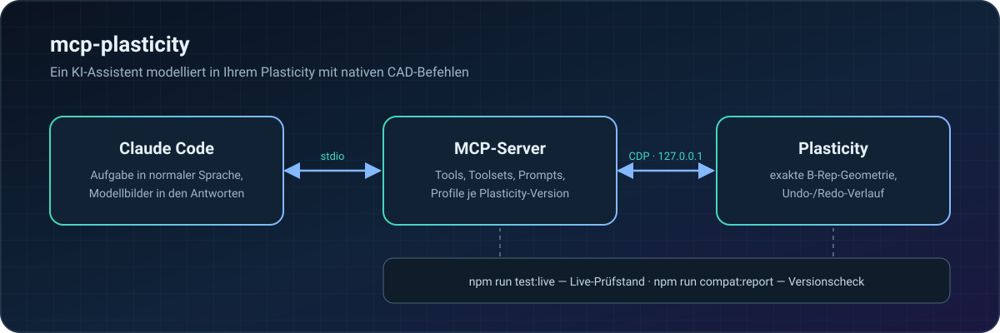

<p align="center">
  <a href="README.md">English</a> ·
  <a href="README.ru.md">Русский</a> ·
  <a href="README.zh-CN.md">简体中文</a> ·
  <a href="README.ja.md">日本語</a> ·
  <a href="README.es.md">Español</a> ·
  <b>Deutsch</b>
</p>

https://github.com/user-attachments/assets/0155abd1-c7cf-4251-885c-a7d4f66c87fc

<p align="center">
  
  
  
  
</p>

**mcp-plasticity** macht [Plasticity](https://www.plasticity.xyz/) zu einem CAD, das ein KI-Assistent bedienen kann. Sie beschreiben die Aufgabe in normaler Sprache, und Claude Code baut das Bauteil in Ihrem Plasticity mit nativen Befehlen: exakte B-Rep-Geometrie, vollständiger Undo/Redo-Verlauf, Messungen und druckfertiger Export. Keine generierten Netze, keine Skripte ins Blaue: Der Assistent sieht sich das Ergebnis an und prüft die Maße selbst.

## Vom Quader zum Gehäuse in vier Aufrufen

Echte Plasticity-Screenshots: Der Assistent hat dieses Teil vollständig über den MCP-Server gebaut.

<table>
  <tr>
    <td width="33%"></td>
    <td width="33%"></td>
    <td width="33%"></td>
  </tr>
  <tr>
    <td align="center"><b>1.</b> Rohteil 90×60×32 mm</td>
    <td align="center"><b>2.</b> Verrundungen R8, Schale 2 mm</td>
    <td align="center"><b>3.</b> 4 M2.5-Dome und 27 Lüftungslöcher</td>
  </tr>
</table>

Nach jedem Schritt ruft der Assistent `plasticity_view` auf und erhält die Bilder direkt in der Antwort, sieht das Teil also genauso wie Sie:

<table>
  <tr>
    <td width="50%"></td>
    <td width="50%"></td>
  </tr>
</table>

## Funktionen

- 🧱 **Modellieren mit nativen Befehlen** — Grundkörper, Boolesche Operationen, Verrundungen und Fasen, Extrusion, Rotation, Sweep und Loft, Kurven, Flächen, Faces und Kanten, Muster und Spiegelungen. Alles landet im Verlauf, Undo/Redo funktioniert wie gewohnt.
- 📐 **Exakte Messungen** — Abmessungen, Volumen, Flächen, Abstände, Spiele, Krümmung, Formschrägen und Durchdringungen, berechnet auf B-Rep statt auf Netzen.
- 🔩 **Fertige Konstruktionselemente** — Bohrungen, Senkungen und Ansenkungen, Taschen für Muttern und Gewindeeinsätze, Schraubdome, Rippen, Lüftung, Schnapphaken, Scharniere, Gehäuseverbindungen.
- 👀 **Der Assistent sieht das Ergebnis** — Viewport-Bilder aus mehreren Ansichten, eingepasst nur auf sichtbare Körper; Kamera und Arbeitsebene des Nutzers werden danach wiederhergestellt.
- 📦 **Dateien und Austausch** — `.plasticity`, STEP, Parasolid, STL, OBJ, 3MF, SVG.
- 🖨️ **Druck und Festigkeit** — Ausrichtung und Aufteilung fürs Druckbett, druckbare Gewinde, Prüfung von Verschraubungen, Festigkeitsabschätzungen.

## So funktioniert es

<p align="center"></p>

## Schnellstart

Sie brauchen macOS auf Apple Silicon, Plasticity 26.1.3 in `/Applications`, Node.js 24+ und Claude Code.

```sh
git clone https://github.com/kad-xyz/mcp-plasticity.git
cd mcp-plasticity
npm install
npm run start:plasticity   # Plasticity mit lokalem Debug-Port (nur 127.0.0.1)
npm run setup:claude       # Plugin für Claude Code
```

Starten Sie Claude Code neu und schreiben Sie zum Beispiel: *„Verbinde dich mit Plasticity und baue ein Gehäuse 90×60×32 mm mit 2 mm Wand“*.

Ist Plasticity bereits ohne Debug-Port geöffnet, schließt `start:plasticity` es nicht: Speichern Sie Ihre Arbeit, beenden Sie die App und führen Sie den Befehl erneut aus.

## Arbeiten mit dem Assistenten

- **Kompaktmodus** (Standard) — die wichtigsten Tools sind sofort sichtbar, alle anderen erreichbar über `plasticity_call` und einen durchsuchbaren Katalog mit Namensvorschlägen und Aufrufbeispielen.
- **Toolsets** — `plasticity_toolsets` listet die Gruppen, `plasticity_enable_toolset` schaltet eine ganze Gruppe frei.
- **Workflows** — MCP-Prompts `plasticity_new_part`, `plasticity_enclosure`, `plasticity_modify_part`, `plasticity_prepare_print`, `plasticity_inspect`, `plasticity_model_from_reference`.
- **Verständliche Fehler** — Meldungen enden mit einer `Next step:`-Zeile und einer konkreten Aktion; Argumentfehler kommen als kurze Feldliste.

Einheiten sind Millimeter und Grad. Verweise auf Faces und Kanten sind an die Dokumentrevision gebunden.

## Kompatibilität

Der Server erkennt die Plasticity-Version und wählt ein Kompatibilitätsprofil. So prüfen Sie, ob Ihre installierte Version alles Nötige bereitstellt:

```sh
npm run compat:report -- --isolated
```

Die Portierung auf eine neue Version ist in [docs/compat.md](docs/compat.md) beschrieben.

## Entwicklung

```sh
npm test && npm run typecheck
npm run test:live          # Live-Prüfstand: separate Plasticity-Instanz, Ihre Dateien bleiben unberührt
npm run test:live:full     # alle Live-Szenarien
```

Berichte landen in `live-runs/<Zeit>-<Stufe>/`. Exit-Codes: `0` — alles bestanden, `1` — Fehler oder Regressionen, `2` — der Prüfstand konnte nicht starten.

Workbench (optional) ist eine lokale Weboberfläche, um das Modell zu prüfen und Notizen vom Tablet zu hinterlassen: `npm run start:workbench`.

## Sicherheit

- Änderungen laufen einzeln und werden gegen die Dokumentrevision geprüft; veraltete Verweise werden abgelehnt.
- Nach einem Timeout zuerst `plasticity_reconcile` aufrufen statt blind zu wiederholen.
- Ein Druckauftrag startet erst nach ausdrücklicher Bestätigung durch den Nutzer.
- Festigkeitswerkzeuge liefern Abschätzungen, keine zertifizierte Ingenieuranalyse.

## Lizenz

[MIT](LICENSE) © 2026 Daniil Kulikov ([kad-xyz](https://github.com/kad-xyz))
