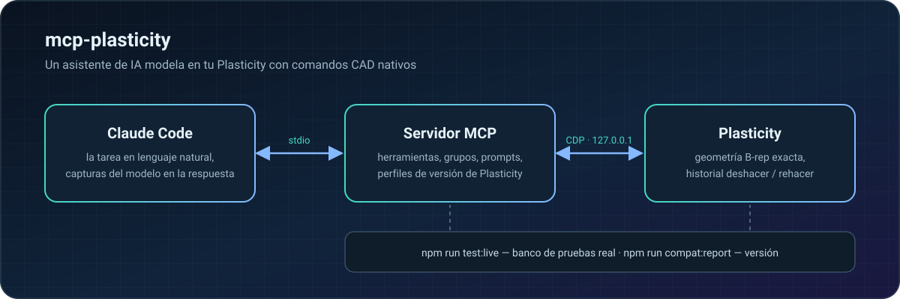

<p align="center">
  <a href="README.md">English</a> ·
  <a href="README.ru.md">Русский</a> ·
  <a href="README.zh-CN.md">简体中文</a> ·
  <a href="README.ja.md">日本語</a> ·
  <b>Español</b> ·
  <a href="README.de.md">Deutsch</a>
</p>

https://github.com/user-attachments/assets/0155abd1-c7cf-4251-885c-a7d4f66c87fc

<p align="center">
  
  
  
  
</p>

**mcp-plasticity** convierte [Plasticity](https://www.plasticity.xyz/) en un CAD que un asistente de IA puede manejar. Describe la tarea con tus propias palabras y Claude Code construye la pieza en tu Plasticity con comandos nativos: geometría B-rep exacta, historial completo de deshacer/rehacer, medidas y exportación lista para imprimir. Nada de mallas generadas ni scripts a ciegas: el asistente mira el resultado y comprueba las medidas por sí mismo.

## De un bloque a una caja en cuatro llamadas

Capturas reales de Plasticity: el asistente construyó esta pieza de principio a fin a través del servidor MCP.

<table>
  <tr>
    <td width="33%"></td>
    <td width="33%"></td>
    <td width="33%"></td>
  </tr>
  <tr>
    <td align="center"><b>1.</b> Bloque de 90×60×32 mm</td>
    <td align="center"><b>2.</b> Redondeos R8, vaciado de 2 mm</td>
    <td align="center"><b>3.</b> 4 torretas M2.5 y 27 orificios de ventilación</td>
  </tr>
</table>

Después de cada paso el asistente llama a `plasticity_view` y recibe las imágenes en la propia respuesta, así que ve la pieza igual que tú:

<table>
  <tr>
    <td width="50%"></td>
    <td width="50%"></td>
  </tr>
</table>

## Funciones

- 🧱 **Modelado con comandos nativos** — primitivas, booleanas, redondeos y chaflanes, extrusión, revolución, barrido y transición, curvas, superficies, caras y aristas, patrones y simetrías. Todo queda en el historial: deshacer/rehacer funciona como siempre.
- 📐 **Medidas exactas** — límites, volúmenes, áreas, distancias, holguras, curvatura, desmoldeo e interferencias, calculados sobre B-rep y no sobre mallas.
- 🔩 **Operaciones de diseño listas** — agujeros, avellanados y escariados, alojamientos para tuercas e insertos térmicos, torretas, nervios, ventilación, encajes a presión, bisagras, uniones de carcasas.
- 👀 **El asistente ve el resultado** — imágenes del visor desde varias vistas, encuadrando solo los cuerpos visibles; la cámara y el plano de trabajo del usuario se restauran después.
- 📦 **Archivos e intercambio** — `.plasticity`, STEP, Parasolid, STL, OBJ, 3MF, SVG.
- 🖨️ **Impresión y resistencia** — orientación y división para la cama, roscas imprimibles, comprobación de tornillería, estimaciones de resistencia.

## Cómo funciona

<p align="center"></p>

## Inicio rápido

Necesitas macOS en Apple Silicon, Plasticity 26.1.3 en `/Applications`, Node.js 24+ y Claude Code.

```sh
git clone https://github.com/kad-xyz/mcp-plasticity.git
cd mcp-plasticity
npm install
npm run start:plasticity   # Plasticity con un puerto de depuración local (solo 127.0.0.1)
npm run setup:claude       # plugin para Claude Code
```

Reinicia Claude Code y pide, por ejemplo: *«Conéctate a Plasticity y haz una caja de 90×60×32 mm con paredes de 2 mm»*.

Si Plasticity ya está abierto sin el puerto de depuración, `start:plasticity` no lo cerrará: guarda tu trabajo, cierra la aplicación y vuelve a ejecutar el comando.

## Trabajar con el asistente

- **Modo compacto** (por defecto) — las herramientas principales se ven desde el principio; el resto se usa mediante `plasticity_call` y un catálogo con búsqueda, sugerencias de nombres cercanos y ejemplos de llamada.
- **Grupos de herramientas** — `plasticity_toolsets` lista los grupos y `plasticity_enable_toolset` activa un grupo completo.
- **Flujos de trabajo** — prompts MCP `plasticity_new_part`, `plasticity_enclosure`, `plasticity_modify_part`, `plasticity_prepare_print`, `plasticity_inspect`, `plasticity_model_from_reference`.
- **Errores claros** — los mensajes terminan con una línea `Next step:` que indica una acción concreta; los errores de argumentos llegan como una lista breve de campos.

Las unidades son milímetros y grados. Las referencias a caras y aristas están ligadas a la revisión del documento.

## Compatibilidad

El servidor detecta la versión de Plasticity y elige un perfil de compatibilidad. Para comprobar que tu versión instalada ofrece todo lo que el servidor necesita:

```sh
npm run compat:report -- --isolated
```

El proceso para adaptarlo a una versión nueva está en [docs/compat.md](docs/compat.md).

## Desarrollo

```sh
npm test && npm run typecheck
npm run test:live          # banco de pruebas real: una instancia aparte de Plasticity, tus archivos no se tocan
npm run test:live:full     # todos los escenarios reales
```

Los informes se guardan en `live-runs/<hora>-<nivel>/`. Códigos de salida: `0` — todo correcto, `1` — fallos o regresiones, `2` — el banco no pudo arrancar.

Workbench (opcional) es una interfaz web local para revisar el modelo y dejar notas desde una tableta: `npm run start:workbench`.

## Seguridad

- Los cambios se ejecutan de uno en uno y se contrastan con la revisión del documento; las referencias obsoletas se rechazan.
- Tras un tiempo de espera agotado, llama primero a `plasticity_reconcile` en lugar de reintentar a ciegas.
- Un trabajo de impresión solo empieza tras la confirmación explícita del usuario.
- Las herramientas de resistencia dan estimaciones, no un análisis de ingeniería certificado.

## Licencia

[MIT](LICENSE) © 2026 Daniil Kulikov ([kad-xyz](https://github.com/kad-xyz))
