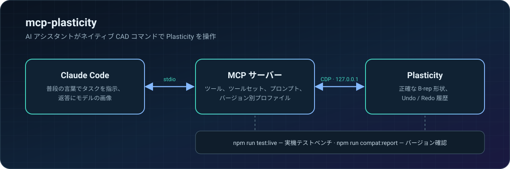

<p align="center">
  <a href="README.md">English</a> ·
  <a href="README.ru.md">Русский</a> ·
  <a href="README.zh-CN.md">简体中文</a> ·
  <b>日本語</b> ·
  <a href="README.es.md">Español</a> ·
  <a href="README.de.md">Deutsch</a>
</p>

https://github.com/user-attachments/assets/cb1fc112-ba36-4e9a-9a96-5dbc41b57455

<p align="center">
  
  
  
  
</p>

**mcp-plasticity** は [Plasticity](https://www.plasticity.xyz/) を AI アシスタントが操作できる CAD にします。普段の言葉でタスクを伝えるだけで、Claude Code があなたの Plasticity 上でネイティブコマンドを使って部品を作ります。正確な B-rep 形状、完全な Undo/Redo 履歴、計測、そして印刷用エクスポート。メッシュの自動生成でも、手探りのスクリプトでもありません。アシスタント自身が結果を見て寸法を確認します。

## 4 回の呼び出しで、箱からケースへ

すべて Plasticity の実際のスクリーンショットです。この部品はアシスタントが MCP サーバー経由で一から作りました。

<table>
  <tr>
    <td width="33%"></td>
    <td width="33%"></td>
    <td width="33%"></td>
  </tr>
  <tr>
    <td align="center"><b>1.</b> 90×60×32 mm のブランク</td>
    <td align="center"><b>2.</b> R8 フィレット、シェル 2 mm</td>
    <td align="center"><b>3.</b> M2.5 ボス 4 本と通気孔 27 個</td>
  </tr>
</table>

各ステップの後、アシスタントは `plasticity_view` を呼び出して返答の中で直接画像を受け取ります。だから、あなたと同じように部品が見えています：

<table>
  <tr>
    <td width="50%"></td>
    <td width="50%"></td>
  </tr>
</table>

## 機能

- 🧱 **ネイティブコマンドでモデリング** — プリミティブ、ブーリアン、フィレットと面取り、押し出し、回転、スイープとロフト、カーブ、サーフェス、面とエッジ、パターンとミラー。すべて履歴に残るので Undo/Redo もいつも通り使えます。
- 📐 **正確な計測** — バウンディングボックス、体積、面積、距離、クリアランス、曲率、抜き勾配、干渉を、メッシュではなく B-rep で計算します。
- 🔩 **すぐ使える設計フィーチャー** — 穴、皿穴とザグリ、ナットやインサート用ポケット、ボス、リブ、通気孔、スナップフィット、ヒンジ、ケースの合わせ部。
- 👀 **アシスタントが結果を見る** — 複数方向からのビューポート画像。表示中のボディだけにフィットし、ユーザーのカメラと作業平面は元に戻されます。
- 📦 **ファイルと交換** — `.plasticity`、STEP、Parasolid、STL、OBJ、3MF、SVG。
- 🖨️ **印刷と強度** — 造形向きと分割、印刷可能なねじ、締結部チェック、強度の概算。

## 仕組み

<p align="center"></p>

## クイックスタート

Apple Silicon の macOS、`/Applications` にある Plasticity 26.1.3、Node.js 24 以上、Claude Code が必要です。

```sh
git clone https://github.com/kad-xyz/mcp-plasticity.git
cd mcp-plasticity
npm install
npm run start:plasticity   # ローカルのデバッグポート付きで Plasticity を起動（127.0.0.1 のみ）
npm run setup:claude       # Claude Code プラグイン
```

Claude Code を再起動し、たとえば *「Plasticity に接続して、肉厚 2 mm の 90×60×32 mm ケースを作って」* と頼んでみてください。

Plasticity がデバッグポートなしですでに開いている場合、`start:plasticity` はそれを閉じません。作業を保存してアプリを終了し、もう一度コマンドを実行してください。

## アシスタントとの作業

- **コンパクトモード**（既定）— 主要ツールはすぐに見え、それ以外は `plasticity_call` と検索可能なカタログから呼び出せます。カタログは近い名前の候補と呼び出し例を示します。
- **ツールセット** — `plasticity_toolsets` でグループを一覧し、`plasticity_enable_toolset` でグループ全体を有効にします。
- **ワークフロー** — MCP プロンプト `plasticity_new_part`、`plasticity_enclosure`、`plasticity_modify_part`、`plasticity_prepare_print`、`plasticity_inspect`、`plasticity_model_from_reference`。
- **わかりやすいエラー** — メッセージの最後に具体的な対処を示す `Next step:` 行が付き、引数エラーは短いフィールド一覧で返ります。

単位はミリメートルと度です。面やエッジの参照はドキュメントのリビジョンに結び付いています。

## 互換性

サーバーは Plasticity のバージョンを判別して互換プロファイルを選びます。インストール済みのバージョンが必要な機能をすべて備えているか確認するには：

```sh
npm run compat:report -- --isolated
```

新しいバージョンへの移行手順は [docs/compat.md](docs/compat.md) にあります。

## 開発

```sh
npm test && npm run typecheck
npm run test:live          # 実機テストベンチ：別の Plasticity インスタンスで実行し、あなたのファイルには触れません
npm run test:live:full     # すべての実機シナリオ
```

レポートは `live-runs/<時刻>-<レベル>/` に保存されます。終了コード：`0` すべて成功、`1` 失敗または回帰あり、`2` テストベンチを起動できない。

Workbench（任意）は、タブレットからモデルを確認してメモを残せるローカル Web UI です：`npm run start:workbench`。

## 安全性

- 変更は 1 つずつ実行され、ドキュメントのリビジョンと照合されます。古い参照は拒否されます。
- タイムアウト後は、やみくもに再試行せず、まず `plasticity_reconcile` を呼び出します。
- 印刷ジョブはユーザーが明示的に確認した後にのみ開始されます。
- 強度ツールの結果は概算であり、認証されたエンジニアリング解析ではありません。

## ライセンス

[MIT](LICENSE) © 2026 Daniil Kulikov（[kad-xyz](https://github.com/kad-xyz)）
