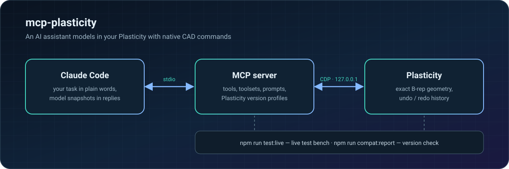

<p align="center">
  <b>English</b> ·
  <a href="README.ru.md">Русский</a> ·
  <a href="README.zh-CN.md">简体中文</a> ·
  <a href="README.ja.md">日本語</a> ·
  <a href="README.es.md">Español</a> ·
  <a href="README.de.md">Deutsch</a>
</p>

https://github.com/user-attachments/assets/0155abd1-c7cf-4251-885c-a7d4f66c87fc

<p align="center">
  
  
  
  
</p>

**mcp-plasticity** turns [Plasticity](https://www.plasticity.xyz/) into a CAD tool an AI assistant can drive. Describe the task in plain words and Claude Code builds the part in your own Plasticity with native commands: exact B-rep geometry, full undo/redo history, measurements and print-ready export. No generated meshes, no blind scripts: the assistant looks at the result and checks the dimensions itself.

## From a box to an enclosure in four calls

Real Plasticity screenshots: the assistant built this part entirely through the MCP server.

<table>
  <tr>
    <td width="33%"></td>
    <td width="33%"></td>
    <td width="33%"></td>
  </tr>
  <tr>
    <td align="center"><b>1.</b> 90×60×32 mm blank</td>
    <td align="center"><b>2.</b> R8 fillets, 2 mm shell</td>
    <td align="center"><b>3.</b> 4 M2.5 bosses and 27 vent holes</td>
  </tr>
</table>

After each step the assistant calls `plasticity_view` and receives images right in the reply, so it sees the part the way you do:

<table>
  <tr>
    <td width="50%"></td>
    <td width="50%"></td>
  </tr>
</table>

## Features

- 🧱 **Native modeling** — primitives, booleans, fillets and chamfers, extrude, revolve, sweep and loft, curves, surfaces, faces and edges, patterns and mirrors. Everything lands in the history, so undo/redo just works.
- 📐 **Exact measurements** — bounds, volumes, areas, distances, clearances, curvature, draft and body intersections, computed on B-rep rather than meshes.
- 🔩 **Ready-made features** — holes, countersinks and counterbores, nut and heat-insert pockets, screw bosses, ribs, vents, snap fits, hinges, enclosure joints.
- 👀 **The assistant sees the result** — viewport images from several views, framing only visible bodies; the user's camera and workplane are restored afterwards.
- 📦 **Files and exchange** — `.plasticity`, STEP, Parasolid, STL, OBJ, 3MF, SVG.
- 🖨️ **Printing and strength** — orientation and splitting for the print bed, printable threads, fastener checks, strength estimates.

## How it works

<p align="center"></p>

## Quick start

You need macOS on Apple Silicon, Plasticity 26.1.3 in `/Applications`, Node.js 24+ and Claude Code.

```sh
git clone https://github.com/kad-xyz/mcp-plasticity.git
cd mcp-plasticity
npm install
npm run start:plasticity   # Plasticity with a local debugging port (127.0.0.1 only)
npm run setup:claude       # Claude Code plugin
```

Restart Claude Code and ask, for example: *"Connect to Plasticity and make a 90×60×32 mm enclosure with 2 mm walls"*.

If Plasticity is already open without the debugging port, `start:plasticity` will not close it: save your work, quit the app and run the command again.

## Working with the assistant

- **Compact mode** (default) — core tools are visible right away; everything else is reachable through `plasticity_call` and a searchable catalog with closest-name suggestions and call examples.
- **Toolsets** — `plasticity_toolsets` lists the groups and `plasticity_enable_toolset` exposes a whole group.
- **Workflows** — MCP prompts `plasticity_new_part`, `plasticity_enclosure`, `plasticity_modify_part`, `plasticity_prepare_print`, `plasticity_inspect`, `plasticity_model_from_reference`.
- **Clear errors** — messages end with a `Next step:` line naming a concrete action; argument errors come as a short list of fields.

Units are millimetres and degrees. Face and edge references are tied to the document revision.

## Compatibility

The server detects the Plasticity version and picks a compatibility profile. To check that your installed version provides everything the server needs:

```sh
npm run compat:report -- --isolated
```

Porting to a new version is described in [docs/compat.md](docs/compat.md).

## Development

```sh
npm test && npm run typecheck
npm run test:live          # live test bench: a separate Plasticity instance, your files stay untouched
npm run test:live:full     # every live scenario
```

Reports are saved to `live-runs/<time>-<tier>/`. Exit codes: `0` — all passed, `1` — failures or regressions, `2` — the bench could not start.

Workbench (optional) is a local web UI for reviewing the model and leaving notes from a tablet: `npm run start:workbench`.

## Safety

- Changes run one at a time and are checked against the document revision; stale references are rejected.
- After a timeout, call `plasticity_reconcile` first instead of blindly retrying.
- A print job starts only after explicit confirmation from the user.
- Strength tools give estimates, not certified engineering analysis.

## License

[MIT](LICENSE) © 2026 Daniil Kulikov ([kad-xyz](https://github.com/kad-xyz))
