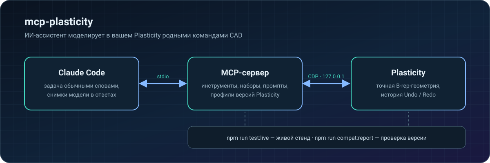

<p align="center">
  <a href="README.md">English</a> ·
  <b>Русский</b> ·
  <a href="README.zh-CN.md">简体中文</a> ·
  <a href="README.ja.md">日本語</a> ·
  <a href="README.es.md">Español</a> ·
  <a href="README.de.md">Deutsch</a>
</p>

https://github.com/user-attachments/assets/cb1fc112-ba36-4e9a-9a96-5dbc41b57455

<p align="center">
  
  
  
  
</p>

**mcp-plasticity** превращает [Plasticity](https://www.plasticity.xyz/) в CAD, которым управляет ИИ-ассистент. Вы пишете задачу обычными словами, а Claude Code строит деталь в вашем Plasticity родными командами: точная B-rep-геометрия, полная история Undo/Redo, измерения и экспорт для печати. Никаких сгенерированных сеток и скриптов «вслепую»: ассистент сам смотрит на результат и проверяет размеры.

## От коробки до корпуса — четыре вызова

Реальные снимки Plasticity: эту деталь целиком построил ассистент через MCP-сервер.

<table>
  <tr>
    <td width="33%"></td>
    <td width="33%"></td>
    <td width="33%"></td>
  </tr>
  <tr>
    <td align="center"><b>1.</b> Заготовка 90×60×32 мм</td>
    <td align="center"><b>2.</b> Скругления R8, оболочка 2 мм</td>
    <td align="center"><b>3.</b> 4 бобышки M2.5 и 27 вентиляционных отверстий</td>
  </tr>
</table>

После каждого шага ассистент вызывает `plasticity_view` и получает изображения прямо в ответ, поэтому видит деталь так же, как вы:

<table>
  <tr>
    <td width="50%"></td>
    <td width="50%"></td>
  </tr>
</table>

## Возможности

- 🧱 **Моделирование родными командами** — примитивы, Boolean, скругления и фаски, вытягивание, вращение, sweep и loft, кривые, поверхности, грани и рёбра, массивы и зеркала. Всё попадает в историю: Undo/Redo работает как обычно.
- 📐 **Точные измерения** — габариты, объёмы, площади, расстояния, зазоры, кривизна, уклоны и пересечения считаются по B-rep, а не по сетке.
- 🔩 **Готовые конструктивные элементы** — отверстия, зенковки и цековки, карманы под гайки и термовставки, бобышки, рёбра, вентиляция, защёлки, шарниры, соединения корпусов.
- 👀 **Ассистент видит результат** — снимки вьюпорта с нескольких видов, вписывание только видимых тел; камера и рабочая плоскость пользователя восстанавливаются.
- 📦 **Файлы и обмен** — `.plasticity`, STEP, Parasolid, STL, OBJ, 3MF, SVG.
- 🖨️ **Печать и прочность** — ориентация и разрезка под стол, печатные резьбы, проверка крепежа, прочностные оценки.

## Как это устроено

<p align="center"></p>

## Быстрый старт

Нужны macOS на Apple Silicon, Plasticity 26.1.3 в `/Applications`, Node.js 24+ и Claude Code.

```sh
git clone https://github.com/kad-xyz/mcp-plasticity.git
cd mcp-plasticity
npm install
npm run start:plasticity   # Plasticity с локальным отладочным портом (только 127.0.0.1)
npm run setup:claude       # плагин для Claude Code
```

Перезапустите Claude Code и напишите, например: *«Подключись к Plasticity и сделай корпус 90×60×32 мм со стенкой 2 мм»*.

Если Plasticity уже открыт без отладочного порта, `start:plasticity` его не закроет: сохраните работу, закройте приложение и запустите команду снова.

## Как работать с ассистентом

- **Компактный режим** (по умолчанию) — основные инструменты видны сразу, остальные доступны через `plasticity_call` и каталог с поиском, подсказками ближайших имён и примерами вызова.
- **Наборы инструментов** — `plasticity_toolsets` показывает группы, а `plasticity_enable_toolset` открывает нужную целиком.
- **Сценарии** — MCP-промпты `plasticity_new_part`, `plasticity_enclosure`, `plasticity_modify_part`, `plasticity_prepare_print`, `plasticity_inspect`, `plasticity_model_from_reference`.
- **Понятные ошибки** — в конце сообщения стоит строка `Next step:` с конкретным действием, а ошибки аргументов приходят коротким списком полей.

Единицы — миллиметры и градусы. Ссылки на грани и рёбра привязаны к ревизии документа.

## Совместимость

Сервер определяет версию Plasticity и выбирает профиль совместимости. Проверить, что установленная версия даёт всё необходимое:

```sh
npm run compat:report -- --isolated
```

Как перенести сервер на новую версию, описано в [docs/compat.md](docs/compat.md).

## Разработка

```sh
npm test && npm run typecheck
npm run test:live          # живой стенд: отдельный экземпляр Plasticity, ваши файлы не трогает
npm run test:live:full     # полный прогон всех живых сценариев
```

Отчёты сохраняются в `live-runs/<время>-<уровень>/`. Коды возврата: `0` — всё прошло, `1` — есть падения или регрессии, `2` — стенд не запустился.

Workbench (по желанию) — локальный веб-интерфейс для просмотра модели и замечаний с планшета: `npm run start:workbench`.

## Безопасность

- Изменения выполняются последовательно и сверяются с ревизией документа; устаревшие ссылки отклоняются.
- После таймаута сначала вызывается `plasticity_reconcile`, повторять операцию вслепую нельзя.
- Задание на печать запускается только после явного подтверждения пользователя.
- Прочностные инструменты дают оценки, а не сертифицированный инженерный расчёт.

## Лицензия

[MIT](LICENSE) © 2026 Куликов Даниил ([kad-xyz](https://github.com/kad-xyz))
