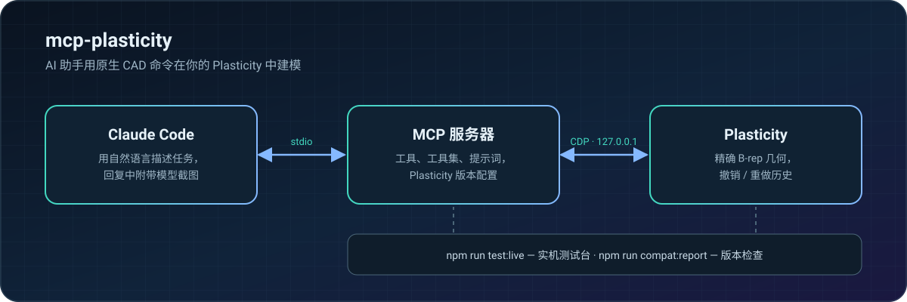

<p align="center">
  <a href="README.md">English</a> ·
  <a href="README.ru.md">Русский</a> ·
  <b>简体中文</b> ·
  <a href="README.ja.md">日本語</a> ·
  <a href="README.es.md">Español</a> ·
  <a href="README.de.md">Deutsch</a>
</p>

https://github.com/user-attachments/assets/cb1fc112-ba36-4e9a-9a96-5dbc41b57455

<p align="center">
  
  
  
  
</p>

**mcp-plasticity** 让 AI 助手可以直接操作 [Plasticity](https://www.plasticity.xyz/)。你用自然语言描述需求，Claude Code 就在你本机的 Plasticity 中用原生命令建模：精确的 B-rep 几何、完整的撤销/重做历史、测量以及可直接打印的导出。不是生成网格，也不是盲目运行脚本——助手会亲自查看结果并核对尺寸。

## 四次调用，从方块到外壳

以下均为 Plasticity 真实截图：这个零件完全由助手通过 MCP 服务器构建。

<table>
  <tr>
    <td width="33%"></td>
    <td width="33%"></td>
    <td width="33%"></td>
  </tr>
  <tr>
    <td align="center"><b>1.</b> 90×60×32 mm 毛坯</td>
    <td align="center"><b>2.</b> R8 圆角，抽壳 2 mm</td>
    <td align="center"><b>3.</b> 4 个 M2.5 螺丝柱与 27 个通风孔</td>
  </tr>
</table>

每一步之后，助手都会调用 `plasticity_view`，直接在回复中拿到图像，像你一样看到零件：

<table>
  <tr>
    <td width="50%"></td>
    <td width="50%"></td>
  </tr>
</table>

## 功能

- 🧱 **原生命令建模** —— 基本体、布尔运算、圆角与倒角、拉伸、旋转、扫掠与放样、曲线、曲面、面与边、阵列与镜像。所有操作都进入历史，撤销/重做照常可用。
- 📐 **精确测量** —— 包围盒、体积、面积、距离、间隙、曲率、拔模与干涉，基于 B-rep 计算而非网格。
- 🔩 **现成的结构特征** —— 通孔、沉头孔与沉孔、螺母与热熔螺母槽、螺丝柱、加强筋、通风孔、卡扣、铰链、外壳接合。
- 👀 **助手能看到结果** —— 多视角视口截图，只框选可见实体；用户的相机和工作平面会被恢复。
- 📦 **文件与交换** —— `.plasticity`、STEP、Parasolid、STL、OBJ、3MF、SVG。
- 🖨️ **打印与强度** —— 打印方向与分割、可打印螺纹、紧固件检查、强度估算。

## 工作原理

<p align="center"></p>

## 快速开始

需要 Apple Silicon 的 macOS、位于 `/Applications` 的 Plasticity 26.1.3、Node.js 24+ 以及 Claude Code。

```sh
git clone https://github.com/kad-xyz/mcp-plasticity.git
cd mcp-plasticity
npm install
npm run start:plasticity   # 以本地调试端口启动 Plasticity（仅 127.0.0.1）
npm run setup:claude       # 安装 Claude Code 插件
```

重启 Claude Code，然后试着说：*“连接 Plasticity，做一个 90×60×32 mm、壁厚 2 mm 的外壳”*。

如果 Plasticity 已经在没有调试端口的情况下打开，`start:plasticity` 不会关闭它：请保存工作、退出应用后再运行命令。

## 与助手协作

- **精简模式**（默认）—— 核心工具直接可见，其余工具通过 `plasticity_call` 和可搜索的目录调用，目录会提示相近名称并给出调用示例。
- **工具集** —— `plasticity_toolsets` 列出分组，`plasticity_enable_toolset` 开启整个分组。
- **工作流** —— MCP 提示词 `plasticity_new_part`、`plasticity_enclosure`、`plasticity_modify_part`、`plasticity_prepare_print`、`plasticity_inspect`、`plasticity_model_from_reference`。
- **清晰的错误** —— 错误信息以 `Next step:` 结尾，给出具体操作；参数错误以简短的字段列表返回。

单位为毫米和度。面和边的引用与文档版本绑定。

## 兼容性

服务器会识别 Plasticity 版本并选择兼容配置。检查已安装版本是否满足服务器的全部需求：

```sh
npm run compat:report -- --isolated
```

迁移到新版本的步骤见 [docs/compat.md](docs/compat.md)。

## 开发

```sh
npm test && npm run typecheck
npm run test:live          # 实机测试台：独立的 Plasticity 实例，不会改动你的文件
npm run test:live:full     # 运行全部实机场景
```

报告保存在 `live-runs/<时间>-<级别>/`。退出码：`0` 全部通过，`1` 有失败或回归，`2` 测试台无法启动。

Workbench（可选）是本地 Web 界面，可在平板上查看模型并留下备注：`npm run start:workbench`。

## 安全

- 修改逐个执行并与文档版本核对；过期引用会被拒绝。
- 超时后先调用 `plasticity_reconcile`，不要盲目重试。
- 打印任务只有在用户明确确认后才会启动。
- 强度工具给出的是估算，而非经过认证的工程分析。

## 许可证

[MIT](LICENSE) © 2026 Daniil Kulikov（[kad-xyz](https://github.com/kad-xyz)）
